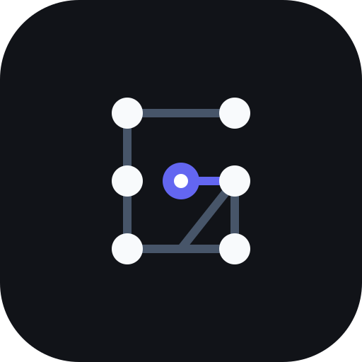
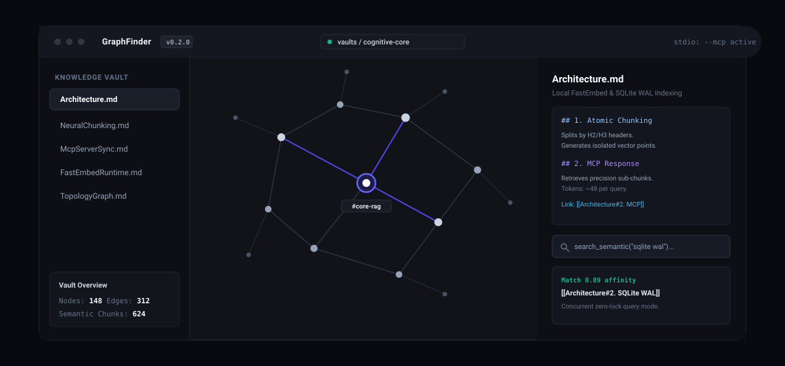
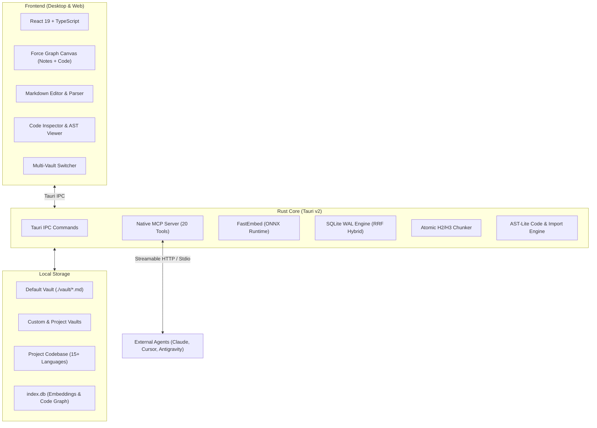

<div align="center">

<br/>



# GraphFinder

### Neural Knowledge Graph & High-Density Semantic Vault for Humans & AI Agents

<p align="center">
  <b>Local-First • Plain Markdown • Atomic Semantic Chunking • Native MCP Server • Zero Cloud Lock-in</b>
</p>

[](https://github.com/GabrielTBeserra/GraphFinder/releases)
[](https://graphfinder.gteles.dev/)
[](https://tauri.app)
[](https://www.rust-lang.org)
[](https://react.dev)
[](https://www.typescriptlang.org)
[](https://modelcontextprotocol.io)
[](LICENSE)

<br/>

<a href="https://graphfinder.gteles.dev/"><b>📖 Live Docs (EN)</b></a> •
<a href="https://graphfinder.gteles.dev/pt/"><b>🇧🇷 Documentação (PT)</b></a> •
<a href="#overview">Overview</a> •
<a href="#key-features">Key Features</a> •
<a href="#ai-agents-skills--mcp-hands-on-tutorial">AI Agents & MCP Tutorial</a> •
<a href="#integrated-mcp-tools-20-tools">MCP Server & Tools</a> •
<a href="#4-terminal-cli--automated-path-detection">CLI & Terminal</a> •
<a href="#architecture">Architecture</a> •
<a href="#getting-started">Getting Started</a> •
<a href="#note-curation-guidelines">Curation</a> •
<a href="#contributing">Contributing</a> •
<a href="#license">License</a>

<br/><br/>



</div>

---

## Overview

**GraphFinder** is a high-performance desktop application designed to bridge human thought workflows with the surgical precision of Artificial Intelligence agents.

Traditional RAG systems slice documents arbitrarily into fixed-length windows or force whole files into LLM context windows, wasting thousands of tokens. Meanwhile, conventional note-taking tools lack local vectorization and atomic semantic query APIs.

**GraphFinder solves this problem:**
1. **For Humans**: A distraction-free, local-first environment to write in pure Markdown, explore connections through an interactive 2D graph, and retain absolute ownership of local files on disk.
2. **For AI Agents**: A native embedded Model Context Protocol (MCP) server delivering sub-section level retrieval (`[[Note#Section]]`), consuming **~50 tokens per query** and eliminating context window pollution.

---

## Key Features

### 1. Hybrid Search (Dense Vectors + BM25 FTS5 via RRF)
* Slices Markdown notes strictly by CommonMark AST headers (`##` and `###`), windowing oversized sections at 320 tokens.
* Combines FastEmbed ONNX dense vectors (offline, 384 dimensions) and SQLite FTS5 full-text keyword indexing using Reciprocal Rank Fusion ($k=60$).
* Zero cloud dependencies, zero API keys, zero data leaves your local machine.

### 2. Interactive 2D Knowledge Graph
* Clean canvas rendering powered by force-directed physics (`force-graph`).
* Real-time topological highlighting of 1-hop and 2-hop neighborhoods.
* Automatic color clustering driven by document hashtag taxonomies (`#architecture`, `#sqlite`, `#mcp`).

### 3. Native Dual-Mode MCP Server
* Embedded HTTP/SSE server on `http://127.0.0.1:45123/mcp` and `http://127.0.0.1:45123/sse` protected by DNS rebinding defense, Origin validation, and strict CSP.
* Standalone Headless Stdio CLI mode via `GraphFinder.exe --mcp` for CLI and terminal agents (Claude Desktop, Cursor, Antigravity).
* Comprehensive 20-tool MCP suite for autonomous note lifecycle, deep linking, AST-lite codebase indexing, and vault integrity inspection.

### 4. Background File Watcher & Instant Sync
* Automatic directory monitoring with debounce (500ms) via `notify-debouncer-mini`.
* Notes and code edited or created externally in VS Code, Cursor, Windsurf, or Neovim are indexed and reflected on the graph in real time.

### 5. Multi-Vault Project Isolation & Refactoring
* Switch or create isolated vaults (`./vaults/<project_id>`) with dedicated vector indices.
* Vault-wide wikilink refactoring: renaming a note automatically updates all incoming `[[Old Title]]` wikilinks across every document in the vault.

### 6. Multi-Language Codebase Indexing & AST Dependency Graph
* **Full-Repo Codebase Scanning**: Automatically parses 15+ languages (Rust, TypeScript, JavaScript, Python, Go, C/C++, Java, Kotlin, C#, PHP, Ruby, Swift, CSS, Shell).
* **AST-Lite Import Graph**: Resolves local imports (`import`, `require`, `use`, `include`, `mod`) and builds bidirectional dependencies between project files.
* **Semantic Code Relations**: Resolves C# namespaces and extracts explicit DI patterns from C#, TypeScript/NestJS, Java/Kotlin constructors, FastAPI `Depends`, Laravel bindings, Swift/C++ constructors, and Go/Rust factories.
* **Static-Analysis Boundaries**: DI edges are emitted only for recognized, statically resolvable syntax; dynamic Ruby/JavaScript wiring and markup/style languages remain import-only.
* **Cybernetic Visual Graph**: Code files are rendered with language-coded concentric rings (TypeScript `#38bdf8`, Rust `#f97316`, Python `#10b981`, Go `#06b6d4`, etc.) and instant filter buttons (`[All]`, `[Notes]`, `[Code]`).
* **Interactive Code Inspector**: Click any code node to inspect top-level symbols (functions, structs, classes), line ranges, token estimates, and jump between imported files.

### 7. Studio White Theme & Vibrant Semantic Graph Palettes
* **Instant Dark / Light Mode Switching**: Native support for studio light mode (`#f8fafc`) and deep dark mode (`#090a0f`), featuring a topbar Sun/Moon toggle with persistent preference saved to `localStorage`.
* **Radial Glow Halos & Concentric Cores**: Central hub nodes emit soft orbital radial illumination gradients proportional to their connection degree, featuring adaptive contrast and colored `#` prefix tag pills.

---

## AI Agents, Skills & MCP Hands-On Tutorial

This comprehensive guide walks you through integrating and operating **GraphFinder** with your **AI Agents** (Cursor, Claude Desktop, Antigravity, Windsurf, Cline), specialized **Agent Skills**, and the **Native MCP Server**.

```
┌──────────────────────────────────────────────────────────────────────────────────┐
│                             THE GRAPHFINDER TRIAD                                │
├──────────────────────┬───────────────────────────┬───────────────────────────────┤
│    1. THE AGENT      │       2. THE SKILL        │          3. THE MCP           │
│  (Cursor, Claude,    │   (graphfinder-curator)   │      (20 Native Tools)        │
│     Antigravity)     │                           │                               │
│  Reasons, plans      │  Enforces strict token    │  Executes semantic retrieval, │
│  and decides which   │  economy, atomic chunking │  surgical code inspection,    │
│  tools to invoke.    │  and semantic linking.    │  note authoring & sync.       │
└──────────────────────┴───────────────────────────┴───────────────────────────────┘
```

---

### 1. Setting Up the MCP Server in Your Editor

GraphFinder provides two primary execution modes via MCP:
- **Mode A (Recommended): HTTP/SSE Server with Desktop App Running**
  - The desktop application automatically hosts the MCP server in the background at `http://127.0.0.1:45123/sse`.
  - **Advantage**: Any notes created or code updated by the agent reflect instantly on the 2D interactive knowledge graph in real time.
- **Mode B: Headless Stdio CLI Mode (No GUI)**
  - Your agent spawns the GraphFinder binary directly via command line (`GraphFinder.exe --mcp` or `cargo run -- --mcp`).
  - **Advantage**: Ideal for terminal environments, headless servers, CI pipelines, or lightweight CLI sessions.

#### A. Cursor IDE (`.cursor/mcp.json` or `~/.cursor/mcp.json`)
Create or edit your MCP configuration file in Cursor:
```json
{
  "mcpServers": {
    "graphfinder": {
      "url": "http://127.0.0.1:45123/sse"
    }
  }
}
```
> **Headless Stdio Tip**: To use Cursor without opening the desktop application GUI:
```json
{
  "mcpServers": {
    "graphfinder": {
      "command": "GraphFinder.exe",
      "args": ["--mcp"]
    }
  }
}
```

#### B. Claude Desktop (`claude_desktop_config.json`)
Configuration file location:
- **Windows**: `%APPDATA%\Claude\claude_desktop_config.json`
- **macOS**: `~/Library/Application Support/Claude/claude_desktop_config.json`

```json
{
  "mcpServers": {
    "graphfinder": {
      "command": "C:\\Path\\To\\GraphFinder.exe",
      "args": ["--mcp"]
    }
  }
}
```

#### C. Google Antigravity / Gemini CLI (`mcp_config.json`)
In your Antigravity configuration directory (`~/.gemini/antigravity-ide/mcp_config.json`):
```json
{
  "mcpServers": {
    "graphfinder": {
      "type": "sse",
      "url": "http://127.0.0.1:45123/sse"
    }
  }
}
```

#### D. Windsurf / Cline / Roo-Code
In your extension's MCP configuration settings:
```json
{
  "mcpServers": {
    "graphfinder": {
      "url": "http://127.0.0.1:45123/sse"
    }
  }
}
```

---

### 2. Understanding and Triggering Agent Skills (`graphfinder-curator`)

Located in `.agents/skills/graphfinder-curator/SKILL.md` is the official **GraphFinder Curator Skill**.

*Skills* serve as dynamic, on-demand operational manuals. Whenever you instruct your agent to:
- *"search the vault for..."*
- *"save our findings into a new note"*
- *"inspect our codebase imports"*
- *"synchronize the repository"*

The agent automatically reads and activates `graphfinder-curator`.

#### The 4 Golden Laws Enforced by the Skill:
1. **Strict Token Economy**:
   - The agent is **strictly prohibited** from reading whole `.md` notes or 500-line source files into the context window.
   - It must always use `search_semantic` or `search_code`, retrieving only atomic excerpts (**~50 to 100 tokens**).
2. **Header-Based Atomic Chunking**:
   - Every generated note starts with `# Title` followed by a concise 2–3 line executive summary.
   - Content subsections under `##` and `###` must remain self-contained and concise (40 to 150 tokens each).
3. **Anti-Orphan Knowledge Linking (`suggest_links`)**:
   - Before calling `store_context`, the agent passes the draft text to `suggest_links(text)`.
   - The engine computes vector affinities and suggests existing relevant notes (e.g. `System Architecture: 85%`). The agent inserts wikilinks `[[Note#Section]]` into the draft, ensuring high topological graph connectivity.
4. **Color-Clustered Tag Taxonomy**:
   - The agent appends lowercase hashtags at the bottom of notes (`#architecture`, `#sqlite`, `#mcp`, `#ai`), driving vibrant visual clustering on the 2D canvas.

---

### 3. Operating Everything via MCP (The 4 Core Workflows)

The GraphFinder MCP server exposes **20 integrated tools**:

```
[User Intent / Agent Goal]
         │
         ├─► [1. Knowledge Retrieval] ────► `search_semantic(query)`
         │                                   ├─► `read_section(target, section)`
         │                                   └─► `get_compressed_context(note_id)`
         │
         ├─► [2. Authoring & Linking] ────► `suggest_links(text)`
         │                                   ├─► `store_context(title, content, tags)`
         │                                   └─► `link_notes(from, to)`
         │
         ├─► [3. Codebase Intelligence] ──► `search_code(query, language?)`
         │                                   ├─► `get_file_context(file)`
         │                                   ├─► `read_code_chunk(file, symbol)`
         │                                   └─► `get_code_dependencies(file)`
         │
         └─► [4. Multi-Vault & Sync] ─────► `list_projects()` / `switch_project(id)`
                                             └─► `sync_vault(project?)`
```

#### Workflow 1: Surgical Knowledge Retrieval
When answering questions about architecture, decisions, or stored documentation:
1. The agent calls `search_semantic(query: "sqlite wal mode")`.
2. The local vector engine returns the top 5 atomic excerpts with affinity scores (~50 tokens each).
3. The agent formulates its response, citing deep links: `[[System Architecture#1. Local Storage and SQLite]]`.
4. If the agent needs a structural outline without reading the full note text, it calls `get_compressed_context(target: "System Architecture")` (**< 80 tokens**).

#### Workflow 2: Saving Knowledge & Long-Term Memory
When completing a task, resolving a complex bug, or documenting a module:
1. The agent drafts the note following the structural standard (`# Title` + summary + `##` sections).
2. The agent calls `suggest_links(text: "draft...")`. GraphFinder returns notes with high semantic affinity.
3. The agent inserts `[[System Architecture]]` into the draft.
4. The agent calls `store_context(title: "Auth JWT", content: "...", tags: ["auth", "security"])`.
5. GraphFinder writes the `.md` file to disk, indexes embeddings in SQLite, and updates the graph canvas immediately.

#### Workflow 3: Navigating & Inspecting Codebase Repositories
When understanding or refactoring code:
1. The agent calls `search_code(query: "hybrid_search", language: "rust")` to find relevant files and functions.
2. The agent calls `get_file_context(file: "src-tauri/src/engine/db.rs")`.
   - Returns: internal imports, external packages (`rusqlite`, `fastembed`), incoming dependents, and declared symbols with exact line ranges and token costs (**< 80 tokens**).
3. The agent calls `read_code_chunk(file: "src-tauri/src/engine/db.rs", symbol: "hybrid_search")`.
   - Surgically reads only the 35 lines of that specific function without dumping the 1,000-line file into context!
4. The agent calls `get_code_dependencies(file: "src-tauri/src/engine/db.rs")` to check architectural impact across the project.

#### Workflow 4: Multi-Vault Management & Incremental Sync
1. `list_projects()`: Lists all configured isolated vaults and note counts.
2. `create_project(name: "NewAPI", path: "C:/Repos/NewAPI")`: Provisions a new isolated vault at any path on disk.
3. `switch_project(project_id: "new-api")`: Toggles the active default vault.
4. `sync_vault(project?)`: Triggers an instant hash-based incremental re-index.

---

### 4. Terminal CLI & Automated Path Detection

GraphFinder includes built-in CLI commands to index, update, or query codebases and vaults directly from your terminal:

```bash
# Sync and index current directory (incremental update if existing, auto-registers if new)
graphfinder sync

# Abbreviated shortcut
graphfinder syn

# Sync a specific path on disk
graphfinder sync Z:\MyProject

# Structured JSON output (ideal for automation scripts and CI pipelines)
graphfinder sync --json

# Display vault and codebase telemetry (notes, code files, graph edges, SQLite stats)
graphfinder status [path]

# List all registered projects and paths
graphfinder projects

# Fast semantic hybrid search directly from terminal
graphfinder search "JWT authentication"

# Launch headless stdio MCP server
graphfinder mcp
```

#### Smart Path Detection:
When running `graphfinder sync`, GraphFinder normalizes the canonical directory path:
- **If the folder is already registered**: It executes a lightning-fast **incremental update via SHA-256**, re-embedding only modified or newly created files.
- **If it is a new folder**: It registers the project automatically, builds the dependency graph, and generates embeddings without manual configuration.

---

### 5. Production Prompt Examples for Your AI Agent

Copy and paste these prompts into your assistant chat (Cursor, Claude, Antigravity, Cline):

| Objective | Example Prompt for Your Agent |
| :--- | :--- |
| **Surgical Vault Search** | *"Query the GraphFinder vault via MCP and explain how AST-based codebase indexing works without reading full files."* |
| **Save Connected Note** | *"Create a new atomic note in GraphFinder documenting our OAuth2 flow. Call suggest_links before saving to connect it to existing architecture notes, and append relevant tags."* |
| **Surgical Code Inspection** | *"Use GraphFinder code tools to find where import parsing is implemented, then inspect only the function signature and body using read_code_chunk."* |
| **Dependency Analysis** | *"Check the code graph to identify which files import `src/components/GraphView.tsx` and summarize the architectural impact."* |
| **Project Synchronization** | *"Synchronize the current workspace in GraphFinder using the sync_vault MCP tool or the CLI command `graphfinder sync`."* |

---

### 6. Mandatory Repository Agent Guidelines (`AGENTS.md`)

GraphFinder includes [AGENTS.md](AGENTS.md) at the repository root.
It defines strict behavioral constraints for AI agents interacting with the knowledge vault and codebase:

- **In Cursor**: Add `@AGENTS.md` to your Project Rules or `.cursorrules`.
- **In Antigravity / Gemini**: The workspace automatically loads `AGENTS.md` as an active behavioral rule.
- **In Claude Desktop**: Paste the contents of `AGENTS.md` into your Project System Prompt.

---

## Integrated MCP Tools (20 Tools)

| Tool | Description | Key Parameters | Token Economy |
| :--- | :--- | :--- | :--- |
| `search_semantic` | Hybrid Dense Vector + BM25 FTS5 search with RRF | `query`, `limit`, `format` | **~90%** savings vs reading full notes |
| `read_section` | Reads a single atomic subsection by heading or deep link | `target`, `section` | Maximum surgical token conservation |
| `get_compressed_context` | Executive summary, backlinks, and section token map | `target` (ID or title) | Full note mapped in **< 80 tokens** |
| `suggest_links` | Analyzes draft text and recommends conceptual wikilinks | `text`, `threshold` | Prevents orphan notes in the graph |
| `store_context` | Writes/updates Markdown note with AST vectorization | `title`, `content`, `tags`, `links` | Persistent local long-term memory |
| `rename_note` | Renames note and refactors all incoming wikilinks | `old_title`, `new_title` | Prevents broken graph edges |
| `delete_note` | Removes note file and cleans SQLite vector records | `target` | Safe note removal |
| `get_vault_stats` | Inspects note count, chunks, links, tags, and tokens | `project` | Graph health monitoring |
| `get_graph_neighborhood` | Returns connected nodes within 1 or 2 hops | `target`, `depth` | Fast topological graph navigation |
| `link_notes` | Creates an explicit bidirectional wikilink between notes | `from_note`, `to_note` | Direct graph relationship creation |
| `list_recent_notes` | Lists notes with single-line summaries and token counts | `limit` | Initial vault mapping |
| `sync_vault` | Hash-based incremental sync between disk and SQLite | `project`, `path` | Fast $O(1)$ re-indexing |
| `list_projects` | Lists all configured isolated knowledge vaults | - | Multi-project discovery |
| `create_project` | Creates a new isolated vault at any path on disk | `name`, `path` | Dynamic multi-vault provisioning |
| `switch_project` | Switches the active default vault | `project_id` | Context switching without cross-pollution |
| `search_code` | Hybrid vector + BM25 search across codebase symbols | `query`, `language`, `limit` | Surgical retrieval across 15+ languages |
| `find_files` | Fast glob pattern matching across indexed files | `pattern`, `limit` | Rapid path and file discovery |
| `get_file_context` | Structural overview (symbols, imports, dependents, pkgs) | `file` | Dense summary in **< 80 tokens** |
| `read_code_chunk` | Reads exact function, class, or struct body | `file`, `symbol` | Surgical reading without entire file |
| `get_code_dependencies` | Directional dependency graph (imports & dependents) | `file` | Architectural impact analysis |

> All tools accept the optional `project: "<id>"` parameter to target specific vaults without cross-project contamination.

---

## Architecture



### Core Technologies
* **Desktop Runtime**: [Tauri v2](https://tauri.app/)
* **Data & Embedding Engine**: [Rust](https://www.rust-lang.org/), [FastEmbed](https://github.com/Anush008/fastembed-rs), [Rusqlite](https://github.com/rusqlite/rusqlite)
* **Frontend UI**: [React 19](https://react.dev/), [TypeScript](https://www.typescriptlang.org/), [Tailwind CSS v4](https://tailwindcss.com/), [Vite](https://vitejs.dev/)
* **Primitives & Icons**: [Radix UI](https://www.radix-ui.com/), [Phosphor Icons](https://phosphoricons.com/)
* **Graph Physics**: [Force-Graph](https://github.com/vasturiano/force-graph)

---

## Getting Started

### Prerequisites
* **Node.js** 20+ ([nodejs.org](https://nodejs.org/))
* **Rust & Cargo** 1.75+ ([rustup.rs](https://rustup.rs/))
* On Windows: C++ Build Tools (Visual Studio C++ Build Tools)

### 1. Clone and Install
```bash
git clone https://github.com/your-username/GraphFinder.git
cd GraphFinder
npm install
```

### 2. Run the Desktop App (Development)
```bash
npm run app
```

### 3. Run the MCP Server Standalone
```bash
npm run mcp
```

### 4. Build Production Bundle
```bash
npm run tauri build
```
Production binaries and installers will be generated under `src-tauri/target/release/bundle/`.

---

## Vault Management

Directory layout of the workspace:

```
GraphFinder/
├── assets/                  # Brand vectors and repository assets
├── public/                  # Static assets and icons
├── src/                     # React 19 / TypeScript frontend
│   ├── components/          # UI components (GraphView, NoteEditor, etc.)
│   ├── services/            # API services and Tauri IPC bindings
│   └── index.css            # Swiss minimalism design system
├── src-tauri/               # Rust backend and MCP server
│   ├── src/                 # Embedding pipeline, SQLite WAL, and IPC handlers
│   └── Cargo.toml           # Rust manifest
├── vault/                   # Default Markdown knowledge vault
└── vaults/                  # Additional isolated vaults and metadata
```

---

## Note Curation Guidelines

To maximize vector retrieval accuracy and token efficiency:

1. **H1 Title and Executive Summary**: Begin each note with `# Note Title` followed by a concise 2-3 line executive summary.
2. **H2 and H3 Sub-sections**: Keep content blocks concise (**40 to 150 tokens**). Use descriptive semantic headers (e.g. `## 2. SQLite WAL Configuration`).
3. **Wikilinks**: Connect concepts using `[[Note Name]]` or `[[Note Name#Section]]` to prevent orphan nodes in the graph.
4. **Taxonomy Hashtags**: Add lowercase tags (e.g. `#architecture #mcp #rust`) at the bottom of topics for visual clustering.

---

## Contributing

GraphFinder is 100% open source under the MIT License. Contributions through bug reports, feature proposals, documentation improvements, and pull requests are warmly welcomed.

* **Contributing Guide**: Check [CONTRIBUTING.md](CONTRIBUTING.md) for local environment setup, architecture notes, and PR guidelines.
* **Code of Conduct**: We adhere to the [Contributor Covenant](CODE_OF_CONDUCT.md).
* **Security Policy**: See [SECURITY.md](SECURITY.md) for responsible vulnerability disclosure.
* **Changelog**: Review release notes and updates in [CHANGELOG.md](CHANGELOG.md).

---

## License

Distributed under the [MIT License](LICENSE). Free for personal, academic, and commercial use.

---

<div align="center">
  <sub>Built for local-first privacy, token economy, and high-density knowledge curation.</sub>
</div>
