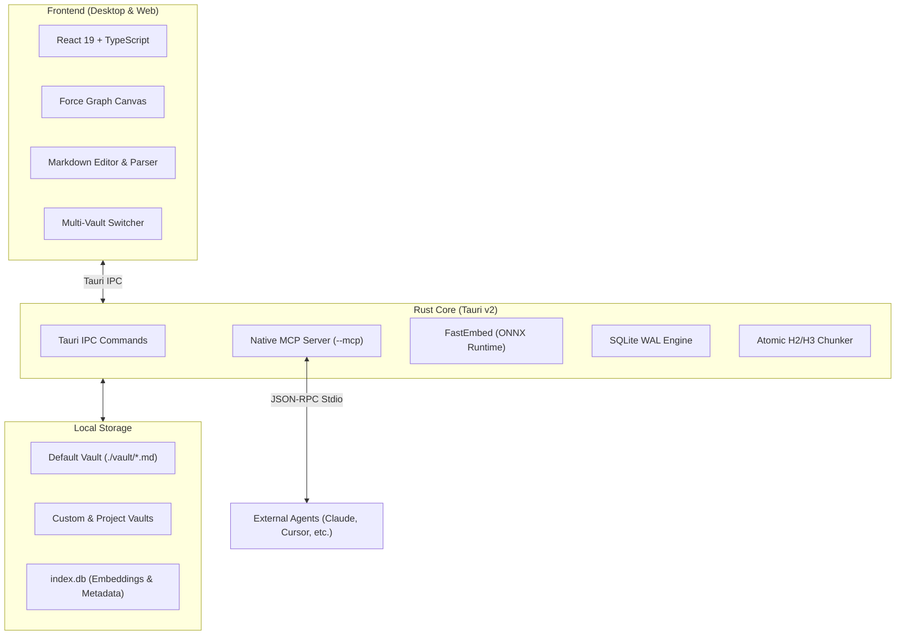

<div align="center">

<br/>


# GraphFinder

### Neural Knowledge Graph & High-Density Semantic Vault for Humans & AI Agents

<p align="center">
  <b>Local-First • Plain Markdown • Atomic Semantic Chunking • Native MCP Server • Zero Cloud Lock-in</b>
</p>

[](https://github.com)
[](https://tauri.app)
[](https://www.rust-lang.org)
[](https://react.dev)
[](https://www.typescriptlang.org)
[](https://modelcontextprotocol.io)
[](LICENSE)

<br/>

<a href="#overview">Overview</a> •
<a href="#key-features">Key Features</a> •
<a href="#mcp-server">MCP Server</a> •
<a href="#architecture">Architecture</a> •
<a href="#getting-started">Getting Started</a> •
<a href="#vault-management">Vaults</a> •
<a href="#note-curation-guidelines">Curation</a> •
<a href="#contributing">Contributing</a> •
<a href="#license">License</a>

<br/><br/>


</div>

---

## Overview

**GraphFinder** is a high-performance desktop application designed to bridge human thought workflows with the surgical precision of Artificial Intelligence agents.

Traditional RAG systems slice documents arbitrarily into fixed-length windows or force whole files into LLM context windows, wasting thousands of tokens. Meanwhile, conventional note-taking tools lack local vectorization and atomic semantic query APIs.

**GraphFinder solves this problem:**
1. **For Humans**: A distraction-free, local-first environment to write in pure Markdown, explore connections through an interactive 2D graph, and retain absolute ownership of local files on disk.
2. **For AI Agents**: A native embedded Model Context Protocol (MCP) server delivering sub-section level retrieval (`[[Note#Section]]`), consuming **~50 tokens per query** and eliminating context window pollution.

---

## Key Features

### 1. Atomic Semantic Chunking
* The Rust vector engine splits Markdown documents strictly by semantic headers (`##` and `###`).
* Each section generates an independent embedding vector via **FastEmbed** (local ONNX runtime, zero cloud dependency, zero API keys required).
* SQLite in WAL mode stores and retrieves chunks and relational metadata concurrently with sub-millisecond response times.

### 2. Interactive 2D Knowledge Graph
* Clean canvas rendering powered by force-directed physics (`force-graph`).
* Real-time topological highlighting of 1-hop and 2-hop neighborhoods.
* Automatic color clustering driven by document hashtag taxonomies (`#architecture`, `#sqlite`, `#mcp`).

### 3. Native MCP Server (`--mcp`)
* The desktop executable doubles as a native Model Context Protocol server over `stdio`.
* Provides 8 ready-to-use tools for clients such as Claude Desktop, Cursor, Gemini Antigravity, Windsurf, and Zed.

### 4. Custom Vaults & Project Isolation
* Save vaults anywhere on your computer (custom directory picker) or in isolated project folders (`./vaults/<project_id>`).
* Zero cross-contamination between clients, research topics, or knowledge bases.

### 5. Local-First & Zero Vendor Lock-in
* Your files stay in standard `.md` format directly on your filesystem.
* 100% open plain Markdown — compatible with any text editor or viewer in the ecosystem.
* Zero data transmitted to third-party cloud servers.

---

## MCP Server

The Model Context Protocol (MCP) enables AI agents to query and curate your knowledge graph with minimal token overhead:

```
[User Question / Agent Intent]
             |
             v
   1. search_semantic(query)
      +--> Returns top atomic sub-sections (~50 tokens each).
             |
             +--> Sufficient detail? ---> Responds citing [[Note#Section]].
             |
             +--> Needs note overview? ---> get_compressed_context(note_id)
                                            (Executive summary + section token map).
```

### Integrated Tools

| Tool | Description | Key Parameters | Token Economy |
| :--- | :--- | :--- | :--- |
| `search_semantic` | Vector similarity search across chunked headers | `query`, `limit`, `format` | **~90%** savings vs reading full notes |
| `get_compressed_context` | Executive summary, backlinks, and section token map | `target` (ID or title) | Full note mapped in **< 100 tokens** |
| `suggest_links` | Analyzes draft text and recommends conceptual wikilinks | `text`, `threshold` | Prevents orphan notes in the graph |
| `store_context` | Writes or updates Markdown note with immediate vectorization | `title`, `content`, `tags`, `links` | Persistent local memory |
| `get_graph_neighborhood` | Returns connected nodes within 1 or 2 hops | `target`, `depth` | Fast topological graph navigation |
| `link_notes` | Creates an explicit bidirectional wikilink between notes | `from_note`, `to_note` | Direct graph relationship creation |
| `list_recent_notes` | Lists notes with single-line summaries and token counts | `limit` | Initial vault mapping |
| `create_project` | Creates a new vault at any path on disk | `name`, `path` | Dynamic multi-vault provisioning |

> All tools accept the optional `project: "<id>"` parameter to target specific vaults without context contamination.

---

### Agent Configuration

#### Claude Desktop (`claude_desktop_config.json`)
```json
{
  "mcpServers": {
    "graphfinder": {
      "command": "cargo",
      "args": [
        "run",
        "--manifest-path",
        "Z:/GraphFinder/src-tauri/Cargo.toml",
        "--",
        "--mcp"
      ]
    }
  }
}
```
*(Or point directly to the compiled executable `graphfinder.exe --mcp`)*

#### Cursor / Gemini Antigravity / Windsurf (`mcp_config.json`)
```json
{
  "mcpServers": {
    "graphfinder": {
      "command": "Z:/GraphFinder/src-tauri/target/release/graphfinder.exe",
      "args": ["--mcp"]
    }
  }
}
```

---

## Architecture



### Core Technologies
* **Desktop Runtime**: [Tauri v2](https://tauri.app/)
* **Data & Embedding Engine**: [Rust](https://www.rust-lang.org/), [FastEmbed](https://github.com/Anush008/fastembed-rs), [Rusqlite](https://github.com/rusqlite/rusqlite)
* **Frontend UI**: [React 19](https://react.dev/), [TypeScript](https://www.typescriptlang.org/), [Tailwind CSS v4](https://tailwindcss.com/), [Vite](https://vitejs.dev/)
* **Primitives & Icons**: [Radix UI](https://www.radix-ui.com/), [Phosphor Icons](https://phosphoricons.com/)
* **Graph Physics**: [Force-Graph](https://github.com/vasturiano/force-graph)

---

## Getting Started

### Prerequisites
* **Node.js** 20+ ([nodejs.org](https://nodejs.org/))
* **Rust & Cargo** 1.75+ ([rustup.rs](https://rustup.rs/))
* On Windows: C++ Build Tools (Visual Studio C++ Build Tools)

### 1. Clone and Install
```bash
git clone https://github.com/SEU_USUARIO/GraphFinder.git
cd GraphFinder
npm install
```

### 2. Run the Desktop App (Development)
```bash
npm run app
```

### 3. Run the MCP Server Standalone
```bash
npm run mcp
```

### 4. Build Production Bundle
```bash
npm run tauri build
```
Production binaries and installers will be generated under `src-tauri/target/release/bundle/`.

---

## Vault Management

Directory layout of the workspace:

```
GraphFinder/
├── assets/                  # Brand vectors and repository assets
├── public/                  # Static assets and icons
├── src/                     # React 19 / TypeScript frontend
│   ├── components/          # UI components (GraphView, NoteEditor, etc.)
│   ├── services/            # API services and Tauri IPC bindings
│   └── index.css            # Swiss minimalism design system
├── src-tauri/               # Rust backend and MCP server
│   ├── src/                 # Embedding pipeline, SQLite WAL, and IPC handlers
│   └── Cargo.toml           # Rust manifest
├── vault/                   # Default Markdown knowledge vault
└── vaults/                  # Additional isolated vaults and metadata
```

---

## Note Curation Guidelines

To maximize vector retrieval accuracy and token efficiency:

1. **H1 Title and Executive Summary**: Begin each note with `# Note Title` followed by a concise 2-3 line executive summary.
2. **H2 and H3 Sub-sections**: Keep content blocks concise (**40 to 150 tokens**). Use descriptive semantic headers (e.g. `## 2. SQLite WAL Configuration`).
3. **Wikilinks**: Connect concepts using `[[Note Name]]` or `[[Note Name#Section]]` to prevent orphan nodes in the graph.
4. **Taxonomy Hashtags**: Add lowercase tags (e.g. `#architecture #mcp #rust`) at the bottom of topics for visual clustering.

---

## Contributing

GraphFinder is 100% open source under the MIT License. Contributions through bug reports, feature proposals, documentation improvements, and pull requests are warmly welcomed.

* **Contributing Guide**: Check [CONTRIBUTING.md](CONTRIBUTING.md) for local environment setup, architecture notes, and PR guidelines.
* **Code of Conduct**: We adhere to the [Contributor Covenant](CODE_OF_CONDUCT.md).
* **Security Policy**: See [SECURITY.md](SECURITY.md) for responsible vulnerability disclosure.
* **Changelog**: Review release notes and updates in [CHANGELOG.md](CHANGELOG.md).

---

## License

Distributed under the [MIT License](LICENSE). Free for personal, academic, and commercial use.

---

<div align="center">
  <sub>Built for local-first privacy, token economy, and high-density knowledge curation.</sub>
</div>
